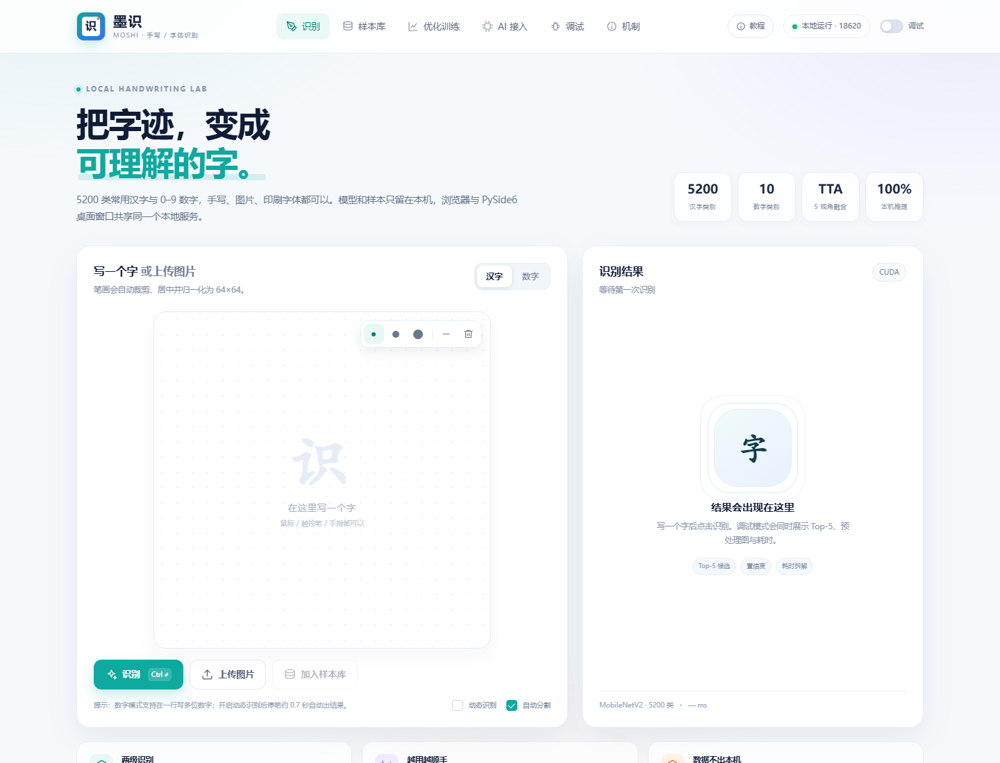
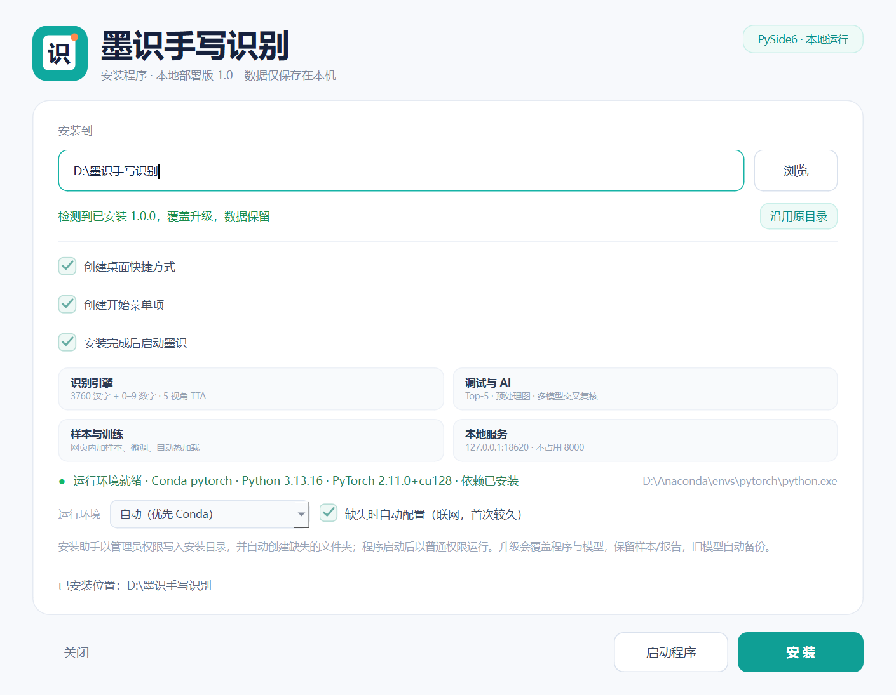
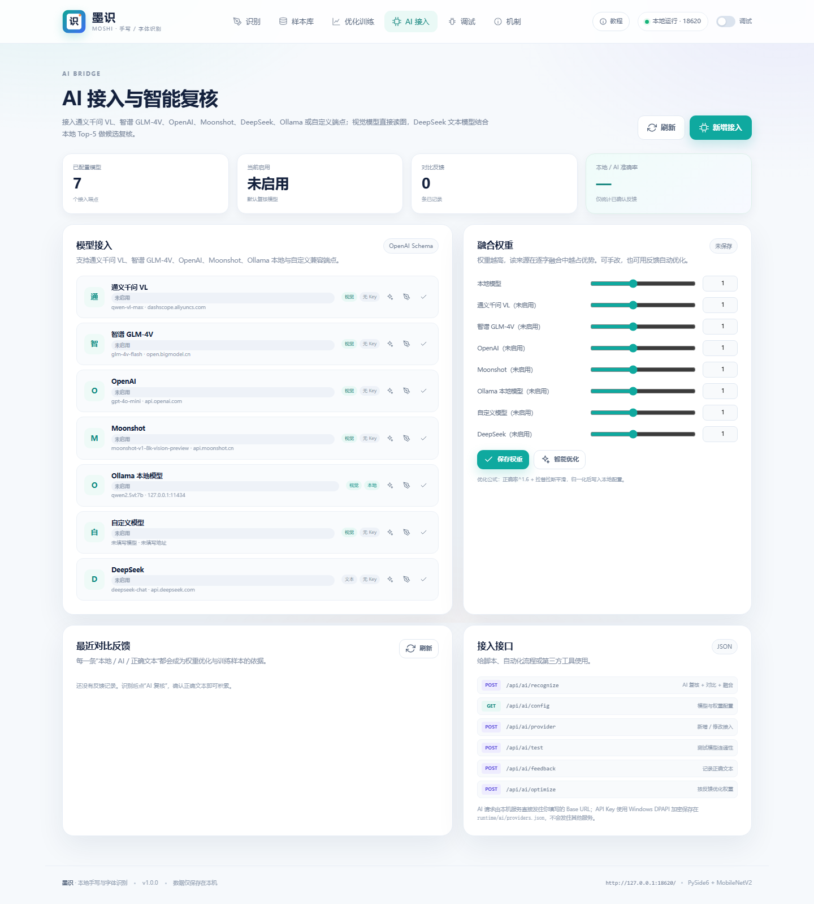
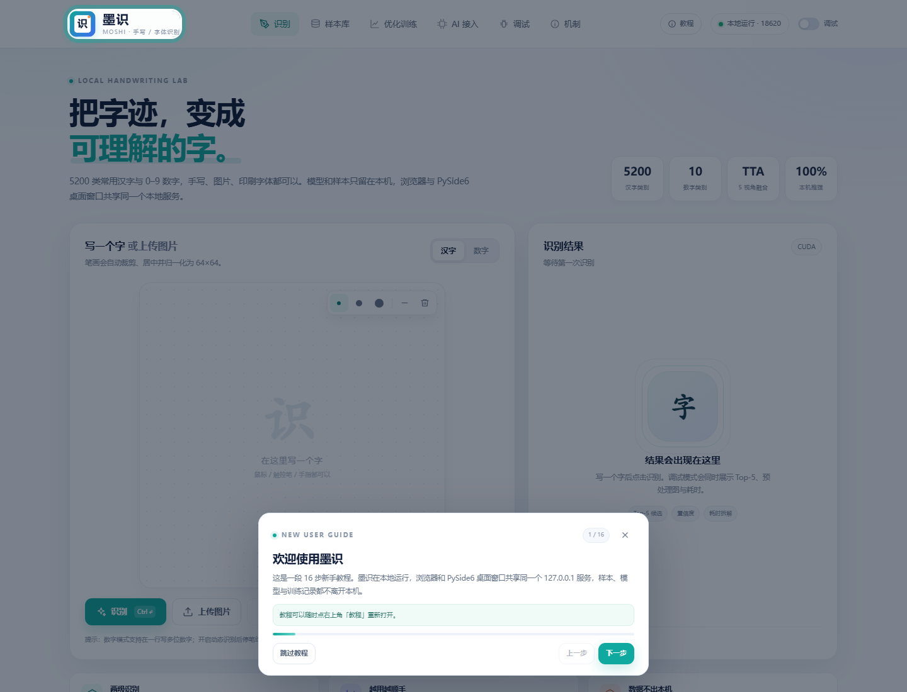
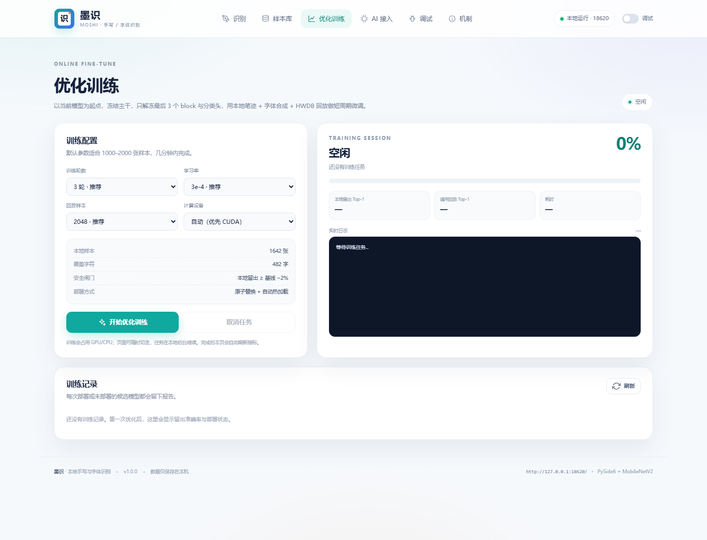
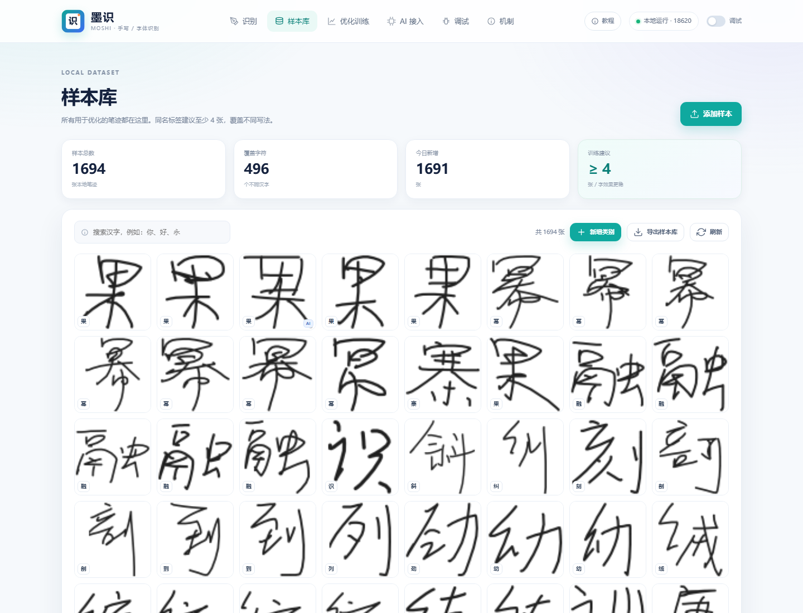
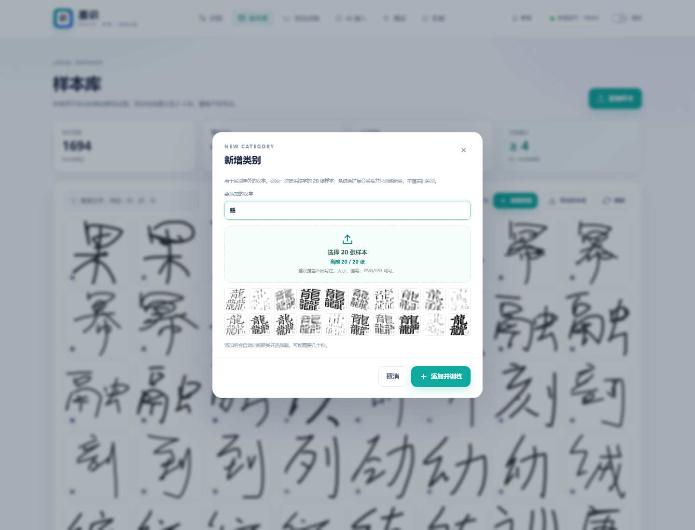

# 墨识 · 手写与字体识别（本地部署版）

> 项目介绍页（可直接作为 GitHub Pages 首页）：[index.html](index.html)  
> GitHub Pages / 百度网盘 / 网页体验版说明：[README-GitHub.md](README-GitHub.md)

一个完全在本机运行的汉字 / 数字识别与优化工具：
**PySide6 桌面显示 + 本地 Web 服务 + 网页内样本管理与微调 + 多模型 AI 交叉复核**。



## 交付物

| 文件 | 说明 |
| --- | --- |
| [release/墨识安装助手.exe](release/墨识安装助手.exe) | 单文件 PySide6 安装助手，内置 1,694 张笔迹、5200 类模型与运行数据 |
| [build/payload.zip](build/payload.zip) | 绿色部署包（解压后运行 `启动墨识.bat`） |
| [机制说明.md](机制说明.md) | 安装、识别、训练、调试、AI、数据与端口的完整机制总结 |
| [AI接入说明.md](AI接入说明.md) | 多模型接入协议、API、权重与训练参与方式 |
| [docs/screenshots](docs/screenshots) | 安装助手、识别、AI、训练、样本库、机制页截图 |

## 快速开始

1. 双击 `release\墨识安装助手.exe`，在 UAC 提示中允许管理员权限（安装器与智能待办助手一样以管理员权限运行）。
2. 选择安装目录（默认 `D:\墨识手写识别`）。目录不存在时会自动创建，不需要手动新建。
3. 勾选桌面 / 开始菜单快捷方式，点击「安装」。程序本身以普通权限运行。
4. 安装助手会把自己复制到桌面（`墨识安装助手.exe`），以后重跑即可覆盖升级。
5. 安装完成后点击「启动程序」，会打开 PySide6 桌面窗口；
   也可以直接访问 **http://127.0.0.1:18620/**。

> 运行环境自适应：有 Conda 时优先使用已有 Conda 环境（如 `pytorch`）；
> 缺失时可按界面选择自动新建 Conda 环境或 venv，并用 pip 下载 torch/torchvision/OpenCV/PySide6。
> 依赖清单在安装目录的 `requirements.txt`。

> 端口刻意避开原来的 `8000`。默认 18620，被占用时自动顺延到 18621–18649。

## 功能

- **手写识别**：5200 类常用汉字，64×64 MobileNetV2，5 视角 TTA；数字 0–9 独立 MnistCNN。
- **动态数字串**：数字模式支持在一行连续写多位，开启动态识别后停笔约 0.7 秒自动出结果。
- **新增类别**：类别库外的汉字可手动添加，必须一次提供 20 张样本；系统扩展分类头、只训练新类，并用旧类回放保护原模型。
- **图片 / 字体识别**：上传印刷体或手写图片，自动极性判断、单行分割、逐字识别。
- **调试台**：Top-5、预处理图、分割框、耗时拆解、环境、日志、原始 JSON。
- **本机硬件记录**：设备型号、CPU、内存、NVIDIA/核显、CUDA 设备均通过注册表/psutil/torch 实时读取，训练报告同时写入；不使用硬编码型号。
- **新手教程**：16 步引导，覆盖识别、上传、标为样本、调试、样本库、训练、AI 接入、权重、端口与升级。
- **样本库**：网页内添加、搜索、删除；「标为样本」已修复，可先修正识别结果再保存；所有样本只在本机。
- **网页内优化训练**：冻结主干、解冻最后 3 个 block 与分类头，本地样本 + 字体合成 + HWDB 回放；安全闸门、自动备份、热加载。
- **AI 接入**：通义千问 VL、智谱 GLM-4V、OpenAI、Moonshot、DeepSeek、Ollama、自定义 OpenAI 兼容端点；
  本地 / AI / 加权融合三栏对比，逐字差异，手动调权重，反馈自动优化；AI 确认标签以 0.65 权重进入训练。
  DeepSeek 预置为**文本复核**（不读图，根据本地 Top-5 候选纠错），也可改成支持视觉的 DeepSeek 端点。
- **样本库导出**：样本库页「导出样本库」下载 ZIP；`导出并重打包.bat` 可把当前样本/模型重新打进安装助手。
- **PySide6 显示层**：桌面窗口用 QWebEngineView 承载同一套白色 Web 界面，与浏览器共享服务与数据。

## 截图

| 安装助手 | AI 接入 |
| --- | --- |
|  |  |

| 新手教程 |
| --- |
|  |

| 优化训练 | 样本库 |
| --- | --- |
|  |  |

## 目录

```text
moshii/
  app/            本地服务、识别、训练、AI、Web 前端
  desktop.py      PySide6 桌面壳
  installer.py    PySide6 安装助手
  scripts/        构建脚本
release/
  墨识安装助手.exe
build/
  payload/        可直接运行的部署目录
  payload.zip     绿色部署包
```

## 新增类别（20 张样本）



1. 打开「样本库」→「新增类别」；
2. 输入一个不在 5200 类字符表中的汉字；
3. 一次选择 **正好 20 张** 该字的 64×64 或任意尺寸图片；
4. 点「添加并训练」。

后端会：

- 将字写入 `runtime/data/custom_chars.json`（升级保留）；
- 分类头追加一行，旧行与主干冻结；
- 用 20 张正样本 + HWDB 回放负样本训练新行，并做旧类保护；
- 通过后原子替换 `current.pth` 并热加载。

## 导出样本库并重新打包

网页「样本库」→「导出样本库」会下载 ZIP（含 64×64 PNG、权重侧车 JSON 和 metadata）。

在项目根目录双击：

```text
导出并重打包.bat
```

或手动执行：

```powershell
D:\Anaconda\envs\pytorch\python.exe moshii\scripts\repack_samples.py ^
  --samples "D:\墨识手写识别\runtime\data\samples" ^
  --name "墨识安装助手-自定义样本"
```

默认会把当前模型 `runtime/models/current.pth` 一起打进去；只想要基础模型加 `--no-model`。
新安装包输出到 `release\墨识安装助手-自定义样本.exe`。

## 更新与重装

- 程序文件与模型总是覆盖；旧模型自动备份到 `runtime/models/backups/upgrade_<时间>/`。
- 用户样本 `runtime/data`、训练报告、AI 配置与日志默认保留。
- 安装助手会停止旧服务后再覆盖，避免文件占用和端口冲突。
- 安装助手自身会复制到桌面，重跑桌面上的 `墨识安装助手.exe` 即可升级/重装。

## 运行环境

- 安装助手优先使用 **Conda** 环境，顺序为 `pytorch` → `moshi` → 其他可用环境；
- 没有可用环境时，可在界面选择「新建 Conda 环境」或「新建 venv」；
- 自动配置会执行 `pip install -r requirements.txt`，需要联网，首次可能较久；
- 没有 Conda 且没有 Python 时，需要先安装 Python 3.10+ 再重新运行安装助手。

## 构建

```powershell
D:\Anaconda\envs\pytorch\python.exe moshii\scripts\build_payload.py
```

需要 Python 3.13（本机 Anaconda pytorch 环境）、PySide6、PyInstaller，以及项目原有的
`hanzi/charset.json`、`hanzi/hanzi_char_mobilenet.pth`、`mnist_cnn.pth`、`hanzi_data/*.npy` 和
`hanzi/user_data/*.png`。

## 数据与安全

- 服务只监听 `127.0.0.1`，不监听局域网。
- 样本、模型、训练报告、AI 反馈都在 `runtime/`；覆盖升级保留。
- AI API Key 在 Windows 上用 DPAPI 加密，接口不回传明文。
- 调用云端 AI 时图片会直接发往你配置的 Base URL；本地识别与训练永不上传。
